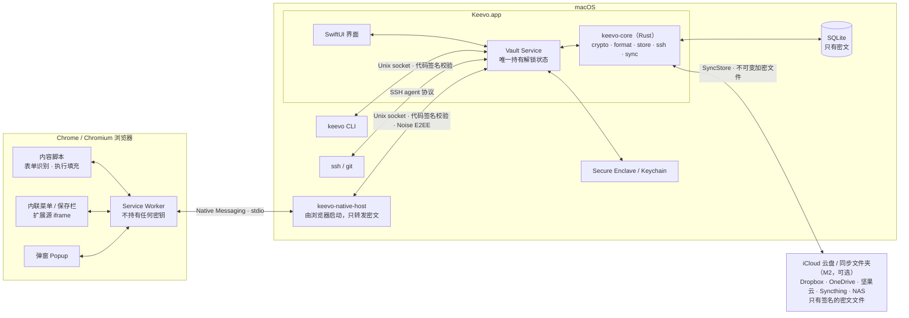
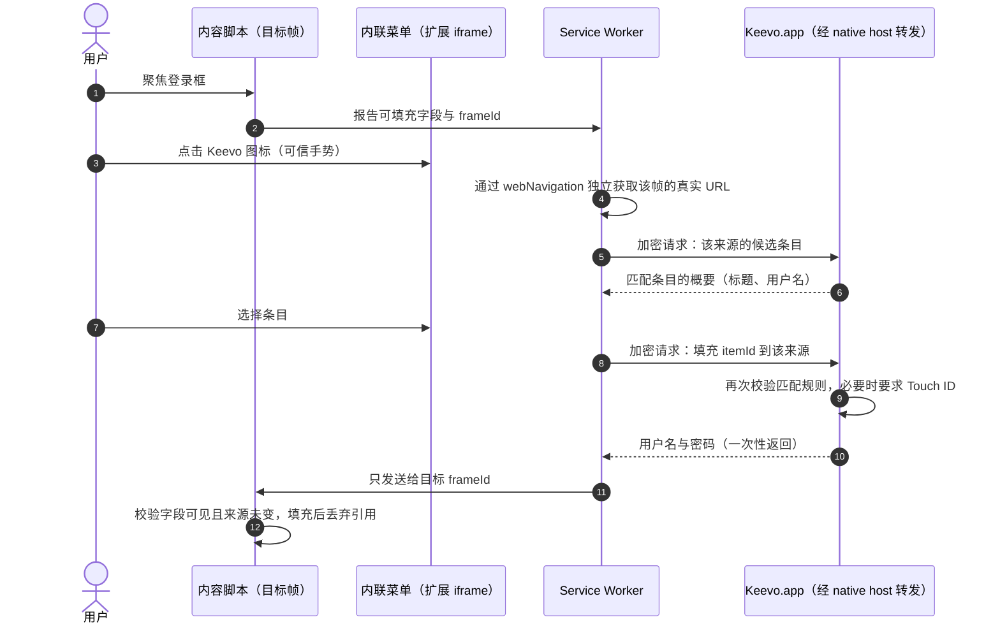

# Keevo 系统架构

## 1. 总览



**核心思想**：
- 所有安全相关逻辑都在 Rust 核心里，只实现一次。
- 桌面应用是唯一持有密钥的地方；扩展、CLI、SSH 客户端都是它的"受控客户端"。
- 同步存储（iCloud、云盘、NAS）只是可选的、不可信的密文搬运通道。Keevo 不运行任何服务端，自身也不发起同步网络请求。

## 2. 技术选型

| 层 | 选择 | 理由 | 备选与不选的原因 |
|---|---|---|---|
| 核心逻辑 | **Rust**（cargo workspace） | 内存安全；一套实现服务 macOS、扩展（WASM）、CLI，以及未来的 Windows / Linux；密码学生态成熟（1Password、Bitwarden 也都用 Rust 写核心） | Go：有 GC，难以可靠清除内存中的秘密，WASM 体积大。各端各写一套：实现不一致本身就是漏洞来源 |
| macOS 应用 | **Swift 6 + SwiftUI**（必要处用 AppKit） | 原生体验最好；与 Touch ID、Secure Enclave、菜单栏的系统集成最好；攻击面比 Electron 小 | Electron：体积大、攻击面大、缺乏原生感。Tauri：跨平台好，但 macOS 原生度与系统扩展支持不如 SwiftUI，可作为未来 Windows/Linux 的候选 |
| Rust ↔ Swift | **UniFFI** | Mozilla 维护；支持 async 与对象句柄；产物打包为 XCFramework | 手写 C ABI：工作量大，易出内存错误 |
| 浏览器扩展 | **TypeScript（strict）+ Svelte 5 + Vite**，Manifest V3 | 编译后运行时极小、依赖少，降低供应链风险；性能好 | React：生态大，但依赖树与包体积更大 |
| 本地存储 | **SQLite**（rusqlite，WAL 模式） | 可靠、支持事务、单文件；行内只存密文 | SQLCipher：应用层已全量加密，整库加密收益有限，可作为后续纵深防御 |
| 云同步（M2） | **基于不可变文件的加密日志**（[sync.md](sync.md)）。iCloud 云盘与其他云盘都是普通文件夹：`NSFileCoordinator` 读写，FSEvents 监听；不需要开发者团队（[ADR-0002](adr/0002-icloud-drive-folder-without-team.md)） | 一套实现覆盖 iCloud、所有云盘和自托管存储；不需要服务端；Keevo 自身零同步网络请求 | CloudKit 与 iCloud 专属容器：需要团队证书，暂不采用。直连各云盘 API：每家都要单独做 OAuth 和适配。自托管服务端：暂缓。详见 [ADR-0001](adr/0001-file-based-cloud-sync.md) |
| 局域网配对（M2） | Network.framework（Bonjour）+ Noise XX | 新 Mac 加入时，安全地传递账户密钥 | — |
| 本地 IPC 加密 | **Noise 协议**（`snow`） | 结构简单、经过广泛分析，支持配对后的静态密钥认证 | 自定义握手：不做 |

> 第三方 crate 与 npm 包引入前都必须通过 `cargo-vet` 或人工审查，见 [governance.md §4](governance.md#4-供应链安全)。

## 3. Rust workspace 模块

| crate | 职责 |
|---|---|
| `keevo-crypto` | **唯一允许直接调用密码学库的 crate**，实现 [spec/crypto.md](../spec/crypto.md)。提供 KDF、2SKD、AEAD、HKDF、随机数、加密信封与 AAD 构造、密钥包裹、账户密钥集，以及密钥类型（释放时清零，不实现 `Debug` / `Display` / `Clone` / 序列化）；包含 RFC 已知答案测试与跨实现测试向量。签名、HPKE 在需要时加入 |
| `keevo-format` | 条目、保险库数据结构（[spec/revisions.md](../spec/revisions.md) 的记录映射）；类型模板；序列化；格式版本迁移 |
| `keevo-store` | 本地持久化：SQLite schema、迁移、事务、备份 |
| `keevo-core` | 账户、保险库与条目操作；解锁状态机；内存搜索索引；密码生成器；TOTP；网址匹配（Public Suffix List）；导入导出；安全中心检查；密钥引用解析 |
| `keevo-ssh` | SSH 密钥生成与解析；SSH agent 协议实现 |
| `keevo-ipc` | 本地 IPC 协议（[spec/ipc.md](../spec/ipc.md)）：帧格式、消息定义、配对与会话状态机。不做 I/O，由 App、native host、CLI 共用。Noise 握手本身在 `keevo-crypto` 中，局域网配对（M2）也复用它 |
| `keevo-sync`（M2） | 同步引擎：日志段、快照、修订图合并、签名与哈希链校验、高水位线。定义 `SyncStore` trait，包含列出文件、读取、原子创建、删除自己的文件、监听变化。文件夹实现写在 Rust 中；iCloud 的下载状态查询与请求下载由 Swift 侧通过 UniFFI 回调接口提供 |
| `keevo-ffi` | 通过 UniFFI 导出给 Swift |
| `keevo-native-host` | Native Messaging 宿主二进制 |
| `keevo-cli` | 命令行工具（M1.4） |
| `keevo-macos` | macOS 平台集成：进程代码签名校验（audit token / pid）。**整个 workspace 唯一允许 `unsafe` 的 crate**，仅限一次 `getsockopt` 调用 |
| `keevo-service` | Vault Service 的 socket 服务：对端校验、连接线程、把 IPC 状态机接到 `keevo-core`；附开发服务 `keevo-dev-service` |
| `keevo-wasm` | 把 `keevo-ipc` 的扩展侧客户端编译为 WASM，扩展与桌面应用共用同一份协议实现 |
| `keevo-wasm`（后续） | 扩展独立模式，供没有桌面应用的平台使用 |

**依赖方向**：`crypto ← format ← store ← core ← {ffi, cli, native-host, sync}`。由 CI 检查：除 `keevo-crypto` 外，任何 crate 都不得直接依赖密码学原语 crate。

## 4. macOS 应用架构

### 4.1 进程模型

- **M1 采用单进程常驻**：开机登录项启动，关闭所有窗口后继续在菜单栏运行。
- **Vault Service** 是应用内的一个模块，持有唯一的解锁状态，为 UI、扩展、CLI、SSH Agent 提供统一接口。
- Vault Service 的接口从 M1 起就**按进程边界设计**（消息化、无共享内存假设）。以后可以把它拆成独立的后台 helper（`SMAppService`）做权限分离，改动将是机械性的。
- **AutoFill 凭据提供扩展**（系统级自动填充）需要团队签发的 entitlement，Keevo 不绑定开发者团队，因此不做（ADR-0003）。

### 4.2 Swift ↔ Rust 边界

- **Rust 持有所有密钥与解密逻辑**，Swift 只拿到需要展示的数据。
- API 按"概要 / 详情"分层：
  - `list_overviews(filter)` 只返回标题、副标题、图标等。
  - `get_item(id)` 才返回完整字段。
- 秘密值以 `SecretValue` **对象句柄**跨越 FFI，Swift 只在显示或复制的瞬间调用 `expose()` 取明文，用完即弃。
- 锁定时 Rust 端清零全部密钥与缓存，并使所有句柄失效。

### 4.3 数据位置

| 内容 | 位置 |
|---|---|
| 保险库数据库（只有密文） | `~/Library/Application Support/Keevo/vault.sqlite`（不使用需要 Team ID 的 App Group 容器，ADR-0003） |
| 附件分块（密文） | `…/attachments/<id>/<n>` |
| 自动备份（密文） | `…/backups/`，可另选外部位置 |
| IPC socket | `…/ipc/`（目录权限 0700） |
| 本机密钥目录 | `…/local/`（目录 0700，文件 0600）：按代次存放 Secure Enclave 密钥的 blob 与包裹，只能在本机解开（`spec/crypto.md` §8.7） |
| 账户密钥 | 本机密钥目录中的用途 0x02 |
| Touch ID 解锁材料 | 本机密钥目录中的用途 0x01：需要用户在场的 Secure Enclave 密钥包裹 AUK |
| 设备 ID | 本机密钥目录中的设备标记（用途 0x04）；数据库中的副本只作缓存（`spec/revisions.md` §8） |
| Vault Service 的 Noise 静态私钥 | 本机密钥目录中的用途 0x03（M1.3） |
| 浏览器配对记录与站点授权 | 加密的保险库数据库，解锁时读入内存（`spec/ipc.md` §4.2） |
| 设备签名密钥（M2） | Secure Enclave，不可导出，仅限本机 |
| iCloud 同步数据（M2） | `iCloud 云盘/Keevo/`（`~/Library/Mobile Documents/com~apple~CloudDocs/Keevo/`），只有密文 |
| 本设备日志段的本地副本（M2） | `…/sync-outbox/` |

**磁盘上不出现任何明文**：
- 窗口状态恢复中不含秘密。
- 日志使用 `%{private}` 并做脱敏。
- 不接入第三方崩溃上报。
- 不建立 Spotlight 索引。

### 4.4 构建与分发

- **M0 空壳**：用 SwiftPM 构建（`scripts/build-macos.sh`），先编译 Rust 库，再生成 UniFFI 绑定，最后编译 Swift。**M1.1** 打包为完整的应用包（含 native host 与 CLI），Rust 核心静态链接。
- **签名**：临时签名 + Hardened Runtime，保留默认的 Library Validation（只放行 Apple 签名的库），因此 Rust 核心静态链接。不公证（ADR-0003）。
- **构建顺序**：先签名 native host 与 CLI，把它们的 cdhash 编译进主程序，再签名主程序（`spec/ipc.md` §3.1）。
- **分发**：GitHub Releases，Sigstore 签名（验证时固定签名身份与 issuer），可复现构建；另提供从源码构建的脚本。首次打开需要用户在"系统设置 → 隐私与安全性"中放行。
- **不启用 App Sandbox**：需要向各浏览器目录写入 Native Messaging 清单、自定义 SSH Agent socket 路径、安装 CLI。不使用任何需要团队签发的 entitlement；不上 Mac App Store。
- **iCloud**：同步使用 iCloud 云盘中的普通文件夹，不需要 iCloud 权限与描述文件（[ADR-0002](adr/0002-icloud-drive-folder-without-team.md)）。
- **团队**：不绑定任何 Apple 开发者团队，也不为 Keevo 申请（[ADR-0003](adr/0003-no-apple-developer-team.md)）。native host 的身份校验改为固定 cdhash；Touch ID 与本机密钥改用 Secure Enclave 包裹的文件（[技术验证](spikes/2026-11-18-secure-enclave-without-team.md)）。
- **局域网配对**：需要声明 `NSLocalNetworkUsageDescription` 与 `NSBonjourServices`，以便触发系统的本地网络权限提示。
- 自动更新用 Sparkle 2（EdDSA 签名，禁止降级），同时提供 Homebrew Cask。
- 提供 Universal 二进制（Apple Silicon 优先）。

## 5. Chrome 扩展架构

### 5.1 组件

| 组件 | 职责 | 持有秘密？ |
|---|---|---|
| Service Worker | 消息路由；维持与 native host 的连接；保存配对后的会话 | 否。只存本扩展的配对静态密钥 |
| 内容脚本（isolated world，所有帧） | 表单识别、字段分类（用户名 / 当前密码 / 新密码 / 验证码）、执行填充、提交检测 | 只在填充瞬间持有 |
| 内联菜单 / 保存栏 | 扩展源 iframe，挂在 closed shadow root 中，并置于顶层（popover） | 只有条目概要 |
| 弹窗 | 搜索、浏览、复制、生成器 | 按需短暂持有 |

约束：不加载远程代码；CSP 为 `script-src 'self' 'wasm-unsafe-eval'`（只为加载扩展包内自带的 WASM）；不使用 `eval`；`externally_connectable` 不开放。

**M0 原型**采用最小权限模式：只申请 `nativeMessaging`、`storage`、`activeTab`、`scripting`，没有任何网站权限；用户点开弹窗、选择条目后，才通过 `chrome.scripting.executeScript` 注入填充函数。内联图标与保存检测在 M1.3 加入。

### 5.2 填充时序



### 5.3 网址匹配

- **默认按可注册域名（eTLD+1）匹配**，内置 Public Suffix List。这是主机与子域规则，**不是严格的同源隔离**：`github.com` 的条目也会匹配 `attacker.github.com` 与 `github.com:8443`。子域被委托给第三方或被接管时，凭据可能被该子域取得；对这类站点，用户应把网址改为主机名精确匹配。
- 每个网址可改为：主机名精确匹配 / URL 前缀匹配 / 从不建议。
- IP 地址与 `localhost` 按"主机 + 端口"精确匹配，方便本地开发多个服务时区分。
- **协议降级不匹配**：HTTPS 条目不在 HTTP 页面填充。
- 引入 Apple `password-manager-resources` 数据集，用于处理共享凭据的域名组（如同一公司的多个域名）、密码规则与修改密码地址。
- **匹配在 Vault Service 中强制执行**，不只依赖扩展判断。

### 5.4 构建

- 固定 Node 版本，用 npm 锁文件（`npm ci --ignore-scripts`），确定性打包，实现**可复现构建**。M0 只用 TypeScript 编译器，没有打包器，运行时 npm 依赖为零。
- 公开发布包与源码构建产物的哈希对比。
- 用 manifest 中的 `key` 固定扩展 ID，使 native host 清单中的 `allowed_origins` 在开发与发布环境下保持稳定。

## 6. 本地 IPC 与信任链

扩展 → native host → Vault Service 这条链路有三层防护：

1. **操作系统层：对端身份校验**
   - Socket 位于数据目录 `~/Library/Application Support/Keevo/ipc/`，目录权限 0700。
   - Vault Service 通过对端的 audit token 取得代码签名，要求对端的 cdhash 等于构建时编译进主程序的 `keevo-native-host` 或 `keevo` CLI 的 cdhash（Keevo 不绑定团队，没有 Team ID 可校验，`spec/ipc.md` §3.1）。
   - native host 启动时检查父进程是否为已知浏览器（按代码签名 Team ID 白名单），并检查 Chrome 传入的扩展来源。浏览器侧的清单 `allowed_origins` 只包含 Keevo 扩展 ID。
   - 父进程检查**只是纵深防御**：同用户进程可以用 fork→exec 让 host 看到一个签名浏览器父进程（`spec/ipc.md` §3.2）。因此设计上假设扩展落盘的静态私钥可能被冒充使用，由第 3 层的按站点授权兜底。
2. **应用层：端到端加密**
   - 扩展与 Vault Service 之间用 Noise 协议建立会话，套件为 `Noise_XX_25519_ChaChaPoly_SHA256`。
   - 首次配对时双方显示由握手哈希派生的短认证串（6 个词），由用户确认一致。
   - 之后用已配对的静态密钥建立会话（`Noise_IK`）。
   - native host 只转发密文，看不到任何内容。
3. **最小披露**
   - 扩展只能拿到"与当前来源匹配的条目"的概要。
   - 秘密值只在用户做出选择后单次返回。
   - 某个配对第一次为某个条目在某个站点取用凭据时，需要在 Keevo.app 的原生界面确认；另有频率限制（`spec/ipc.md` §5.2）。
   - 配对可以按浏览器撤销，撤销立即断开已建立的会话。

**CLI**：
- 同样经 socket 连接并校验代码签名。从源码自行编译的 CLI 首次连接时，需要在 App 中显式信任该二进制（固定其 cdhash）。
- 授权按"终端会话"划分（TTY + 父 shell 进程），默认闲置 10 分钟失效。

## 7. CLI 设计

| 命令 | 作用 |
|---|---|
| `keevo status` | 显示连接、锁定与授权状态 |
| `keevo read <ref>` | 读取单个字段 |
| `keevo run [--env-file F] [--env <ref>] -- <cmd>` | 解析引用后注入环境变量并运行子进程；默认通过伪终端代理遮蔽输出中的秘密，可用 `--no-masking` 关闭 |
| `keevo inject -i <tpl> -o <out>` | 渲染含引用的配置模板，输出文件权限为 0600 |
| `keevo item list/get/create/edit` | 条目操作，支持 `--format json` |
| `keevo totp <item>` | 输出当前验证码 |
| `keevo generate` | 生成密码或密码短语 |
| `keevo ssh config` | 输出或写入 SSH 配置片段 |
| `keevo lock` | 立即锁定 |

**原则**：
- 默认人类可读，`--format json` 供脚本使用。
- 除非显式指定 `--reveal`，否则不在终端打印秘密。
- 退出码有文档说明且稳定。

## 8. SSH Agent

- **Socket**：`~/Library/Application Support/Keevo/ssh/agent.sock`，另提供便捷软链 `~/.keevo/agent.sock`。
- **支持的算法**：Ed25519、`rsa-sha2-256/512`、ECDSA P-256 签名。只暴露标记为"在 Agent 中可用"的密钥，**不接受 `ssh-add` 加入外部密钥**。
- **授权**：
  - 通过 socket 对端 PID 解析进程树，识别出终端应用与具体命令，显示在授权弹窗里。
  - 按密钥设置的策略决定是否需要 Touch ID。
- **识别转发**：支持 OpenSSH 的 `session-bind@openssh.com` 扩展，识别目标主机与 agent 转发场景；转发请求单独授权，并给出风险提示。
- **避免"Too many authentication failures"**：密钥较多时，服务器可能因尝试次数过多而拒绝连接。Keevo 会把公钥导出到 `~/.ssh/keevo/<name>.pub`，并在配置助手中按主机生成 `IdentityFile` + `IdentitiesOnly` 配置。
- **Git 签名**：通过 Agent 完成 `ssh-keygen -Y sign`，并随附 `keevo-ssh-sign` 作为兼容方案。

## 9. 仓库结构

```
keevo/
├── crates/
│   ├── keevo-crypto/
│   ├── keevo-format/
│   ├── keevo-store/
│   ├── keevo-core/
│   ├── keevo-ssh/
│   ├── keevo-ipc/
│   ├── keevo-sync/            # M2：云同步引擎
│   ├── keevo-ffi/
│   ├── keevo-native-host/
│   └── keevo-cli/
├── tools/uniffi-bindgen/     # 构建工具：生成 Swift 绑定
├── apps/
│   ├── macos/                 # SwiftUI 应用（SwiftPM 构建，scripts/package-macos.sh 组装为 Keevo.app）
│   └── browser-extension/     # MV3 扩展（TypeScript + Svelte）
├── spec/                      # 可审计规范：加密、保险库格式、IPC、同步协议 + 测试向量
├── design/                    # 设计令牌、图标
├── docs/                      # 设计文档、ADR、用户文档
├── fuzz/                      # cargo-fuzz 目标
├── scripts/                   # 构建、发布、可复现构建校验
└── .github/                   # CI、CODEOWNERS、SECURITY.md、Issue/PR 模板
```

## 10. 工程实践

### 10.1 CI

- **Rust**：`cargo fmt --check`、`clippy -D warnings`、`cargo test`、`cargo-deny`（许可证、禁用 crate、安全公告）、`cargo-vet`。
- **Swift**：swift-format、XCTest、XCUITest。
- **扩展**：`tsc --strict`、ESLint、Vitest、Playwright 端到端测试。

### 10.2 测试策略

| 类别 | 做法 |
|---|---|
| 密码学 | 已知答案测试；跨实现测试向量（Rust 原生、WASM，以及将来的第三方实现都必须通过同一组向量） |
| 属性测试 | `proptest`：序列化往返、合并算法收敛、迁移幂等 |
| 模糊测试 | 覆盖所有解析器：导入文件、`otpauth://` URI、SSH 密钥、IPC 帧、Native Messaging 消息、同步响应 |
| 自动填充回归语料库 | 收集数百个真实登录/注册页面的本地快照，覆盖常见站点与前端框架；每次改动都统计识别准确率 |
| 迁移 | 每个发布版本都留存 fixture 保险库，最新版本必须能打开全部历史版本 |
| 秘密泄露检测 | 用带特征标记的秘密跑端到端测试，然后扫描日志、磁盘文件、崩溃转储，不得出现明文 |
| 云盘行为模拟（M2） | 确定性模拟测试，场景包括：文件延迟与乱序到达、半截文件、冲突副本、未下载的占位文件、文件被删除或回滚、设备离线超过 30 天、设备克隆、无密钥的攻击者注入文件。断言：所有设备最终一致，且零数据丢失 |

### 10.3 发布与审查

- **发布**：签名 tag；GitHub Actions 构建（Action 固定到提交 SHA）；SLSA 来源证明；Sigstore 签名；CycloneDX SBOM；发布说明附哈希。
- **代码审查**：`crates/keevo-crypto`、`crates/keevo-ipc`、`spec/` 等安全敏感路径，通过 CODEOWNERS 强制要求安全负责人审查。
