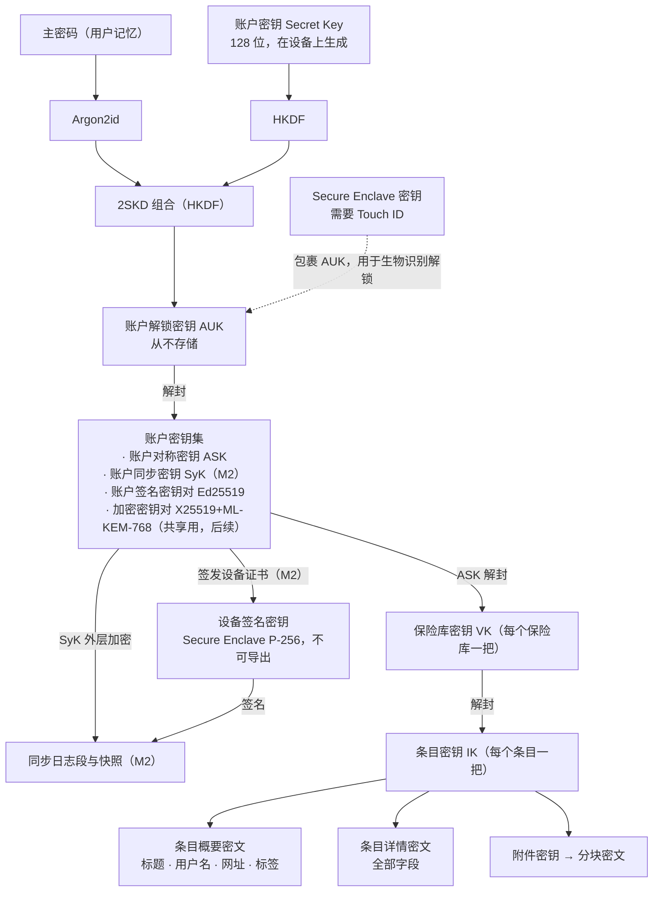

# Keevo 安全设计

> 本文是安全设计的总纲。实现前会拆成可审计的规范放在 `spec/`，并附测试向量。实现与规范有任何偏离，都必须先修改规范、经过评审。

## 1. 安全目标与非目标

| # | 目标 |
|---|---|
| G1 机密性 | 不持有"主密码 + 账户密钥"、也没有已解锁设备的人，无法获得保险库中的任何内容，**包括标题、网址、标签等元数据** |
| G2 完整性 | 对密文的篡改、替换、移植、回滚、删除，都能被客户端检测到 |
| G3 抗离线破解 | 即使攻击者拿到全部密文（云盘账户被盗、同步文件或备份泄露），且主密码偏弱，暴力破解仍然不可行 |
| G4 最小信任 | 同步存储及其提供方（iCloud、各家云盘、NAS，以及任何能访问同步文件夹的人）被视为不可信 |
| G5 静态安全 | 设备处于锁定状态时，磁盘上不存在可用的明文或密钥 |
| G6 可恢复 | 在不破坏 G1–G4 的前提下，用户可以凭应急包恢复访问 |

**非目标**（会尽量提高攻击门槛，但不承诺防护）：
- 已取得 root 或内核权限、或能注入 Keevo 进程的恶意软件。
- 替换磁盘上的 Keevo 主程序（ADR-0003）。Keevo 采用拖拽安装、临时签名，同用户进程可能有权改写应用包；替换主程序等同于替换 Keevo 本身。辅助程序（native host、CLI）的身份由编译进主程序的 cdhash 校验，只替换它们无效（`spec/ipc.md` §3.1）。macOS 的"App 管理"保护能否阻止这类修改，待 M1.1 验证。
- 硬件键盘记录器。
- 用户在已解锁设备上被胁迫。

## 2. 资产

| 资产 | 敏感度 |
|---|---|
| 保险库明文（含元数据） | 极高 |
| 主密码、账户密钥、各级密钥 | 极高 |
| 网站账户分布（你在哪些网站有账户） | 高。元数据也是数据 |
| 使用模式（条目数量、修改时间、IP） | 中 |

## 3. 攻击者模型

| # | 攻击者 | 能力 | 主要防护 | 残余风险 |
|---|---|---|---|---|
| A1 | 密文窃取者 | 拿到 SQLite 文件、本地备份，或同步文件夹中的文件（包括云盘保留的历史版本） | 2SKD（128 位账户密钥）+ Argon2id；全量加密 + 长度填充；应急轮换 | 若应急包同时泄露，安全性退化为主密码强度 |
| A2 | 不可信的存储提供方，或任何能写入同步文件夹的人 | 读取、修改、删除、回滚同步文件；扣留新文件；伪造设备或日志 | 2SKD；日志段整体外层加密；AEAD + AAD 上下文绑定；设备证书由账户密钥签发；每台设备一条签名的哈希链 + 高水位线；单写者、不可变文件；客户端硬编码 KDF 下限 | 可以删除文件或阻止同步，但本地副本不受影响；可以扣留最新数据而不被立即发现；能观察文件数量、大小和写入时间 |
| A3 | 网络攻击者 | 中间人 | Keevo 自身不发起同步网络连接，传输交给系统或云盘客户端；内容已端到端加密 | 流量分析 |
| A4 | 恶意网站 | 钓鱼页面、隐藏表单、点击劫持、跨域 iframe | 来源绑定匹配；只在用户手势后填充；不填充不可见字段；内联 UI 隔离与可见性检测；默认不填充跨域 iframe | 用户在警告后仍主动向钓鱼站点填充 |
| A5 | 合法网站上的 XSS | 读取 DOM、伪造表单 | 秘密不预先放入 DOM；只在用户选择后填充 | 填充后，XSS 可以读到已填写的值（所有密码管理器的共同局限） |
| A6 | 其他恶意浏览器扩展 | 读取页面、尝试与 Keevo 通信 | native host 只接受 Keevo 扩展 ID；`externally_connectable` 不开放 | 有页面权限的扩展能读到已填写的值 |
| A7 | 以同一用户身份运行的恶意软件 | 读文件、连接 socket、启动进程 | 磁盘上只有密文；本机密钥由 Secure Enclave 包裹，无法在其他设备上使用（但同用户进程可以在本机调用不需要用户在场的那几把，`spec/crypto.md` §8.7）；Touch ID 解锁材料需要用户在场；IPC 校验 socket 对端代码签名；扩展取用凭据按站点在原生界面授权并限频（`spec/ipc.md` §5.2）；敏感操作需 Touch ID；Agent 和 CLI 请求显示来源进程 | 解锁期间可以截屏、记录键盘、读剪贴板；可以读出扩展落盘的静态私钥，并绕过 native host 的父进程检查（fork→exec，评审 2026-11-18 F2）冒充已配对的扩展，取得**已授权站点**的凭据（受频率限制）；可以在本机解开账户密钥（安全性退化为主密码与 KDF）与 Vault Service 的静态私钥（可冒充服务与扩展握手）。不在完全防护范围内 |
| A8 | 能接触已解锁电脑的人 | 物理访问 | 自动锁定；敏感操作重新验证 | 锁定前的窗口期 |
| A9 | 供应链攻击者 | 污染依赖、构建系统或发布渠道 | 依赖审查、锁文件、可复现构建、签名发布、最小依赖 | 首次信任 |
| A10 | 恶意或被胁迫的维护者 | 推送恶意代码 | 全部开源；关键路径多人审查；发布密钥多人持有；构建来源证明 | 用户需要选择信任某个经过审计的版本 |

## 4. 密钥体系



**设计要点**：
- **个人保险库的密钥包裹全部是对称的**（ASK → VK → IK）。公钥体系只用于将来的共享，因此不存在"先存储、等量子计算机再解密"的风险（见 §14）。
- **每个条目一把密钥**：
  - 将来可以单独共享某个条目。
  - 限制单把密钥加密的数据量。
  - 密钥轮换可以局部进行。
- **修改主密码**只需重新包裹密钥集，复杂度 O(1)，不需要重新加密任何条目。怀疑密钥泄露时，另有会重新加密全部数据的"应急轮换"（见 §10）。
- **概要与详情分开加密**：列表与搜索只解密概要；完整字段只在打开条目时解密。

## 5. 算法清单

| 用途 | 算法 | 参数 |
|---|---|---|
| 口令派生 | Argon2id（RFC 9106） | 默认 m = 256 MiB、t = 3、p = 4，按设备校准到约 1 秒。**客户端硬性下限 m = 64 MiB、t = 3**。salt 16 字节随机 |
| 密钥派生与组合 | HKDF-SHA-256（RFC 5869） | `info` 带版本与用途，做域分隔，如 `keevo/v1/auk` |
| 对称加密 | XChaCha20-Poly1305 | 256 位密钥；192 位随机 nonce（随机生成也无碰撞之忧）；16 字节 tag |
| 账户签名 | Ed25519 | 签发设备证书、账户文件、撤销记录 |
| 设备签名（M2） | ECDSA P-256（Secure Enclave） | 签名日志段与快照；私钥不可导出 |
| 公钥加密（共享，后续） | HPKE（RFC 9180）+ X-Wing 混合 KEM（X25519 + ML-KEM-768，IETF 草案） | — |
| 哈希 | SHA-256 | 统一使用一种哈希，减少原语种类 |
| 本地 IPC、局域网配对 | `Noise_XX/IK_25519_ChaChaPoly_SHA256` | — |
| 随机数 | 操作系统 CSPRNG（`getrandom`） | — |
| TOTP | HMAC-SHA-1/256/512（RFC 6238） | — |
| 生物识别包裹 | Secure Enclave P-256 ECDH（CryptoKit，密钥以 blob 存成文件）+ HKDF-SHA256 + XChaCha20-Poly1305（核心层，`spec/crypto.md` §8.7） | 访问控制 `privateKeyUsage` + `biometryCurrentSet` |

**算法敏捷性**：
- 每个信封都带 `format_version` 与 `alg_id`。
- 升级算法时，在下一次写入时重新加密。
- 客户端拒绝未知或已弃用的算法，**不存在"协商降级"**。

## 6. 双因子密钥派生（2SKD）

```
P          = NFKD(主密码)
K_p        = Argon2id(P, salt_p, m, t, p)                                 // 32 字节
K_s        = HKDF-SHA256(ikm = SecretKey, salt = account_id, info = "keevo/v1/secret-key")
IKM        = K_p ‖ K_s
AUK        = HKDF-SHA256(ikm = IKM, salt = account_id, info = "keevo/v1/auk")
```

`info` 中的 `keevo/v1/opaque` 预留给将来的服务端认证（见 [future/self-hosted-server.md](future/self-hosted-server.md)），与 AUK 相互独立。

- **NFKD 规范化**：同一个密码在不同设备、不同输入法下可能产生不同的字节（例如中文输入法下的全角与半角字符）。规范化后，用户在任何地方都能正常解锁。
- **账户密钥格式**：`K1-` 前缀 + 128 位随机数的 Crockford Base32 编码（26 个字符）+ 校验字符，分组显示，方便抄写和防止笔误。
- **为什么要账户密钥**：
  - 人类选择的主密码熵有限；仅靠 Argon2，面对大规模 GPU 集群仍有被破解的可能。
  - 加入 128 位随机的账户密钥后，离线破解变得完全不可行。
  - 开启同步后，加密的密钥集就放在你的 iCloud 或云盘里。有了账户密钥，即使这份文件被人拿走，也无法破解。
  - 用户日常仍然只需记住主密码：账户密钥由本机的 Secure Enclave 密钥包裹后保存（`spec/crypto.md` §8.7），新设备通过局域网配对或扫码获得。
  - 代价是必须妥善保存应急包。这一点由体验设计来缓解（见 [ux.md §3.1](ux.md#31-首次使用目标--3-分钟)）。

## 7. 加密信封格式

```
Envelope v1 {
  v      : u8        = 1
  alg    : u8        = 1            // XChaCha20-Poly1305
  kid    : [u8; 16]                 // 加密所用密钥的 ID
  nonce  : [u8; 24]
  ct     : bytes                    // 密文，含 16 字节 tag
}

AAD = fixed_binary_encode(
  v, alg, kid, object_type, account_id, vault_id, object_id,
  part,        // "overview" | "details" | "attachment:<n>" | "wrapped_key"
  rev_id
)
```

- **AAD 上下文绑定**：存储提供方或任何篡改者都无法把一个条目的密文"移植"到另一个条目、保险库或修订，也无法互换概要与详情，或把旧修订的密文冒充成另一个修订。
- **明文**：带 `schema_version` 的 JSON，便于演进和调试；AAD 使用定长二进制编码，保证规范唯一。
- **长度填充**：用 Padmé 方案把明文填充到长度桶，**降低**长度信息的精度。不超过 252 字节的明文全部落在同一个桶中；更大的文档仍会泄露长度区间及其变化，在已知条目模板时可能推断出密码长度的范围。因此只能说"降低长度泄露"，不能承诺隐藏备注长短（评审 2026-11-18 C5）。
- **附件**：每个文件一把随机密钥，按 1 MiB 分块。每块独立 nonce，AAD 含块序号与"是否最后一块"标记，防止截断和重排（STREAM 构造）。

## 8. 本地解锁与设备上的密钥

- **主密码解锁**：2SKD → AUK → 解封密钥集。
- **Touch ID 解锁**：
  - 用户启用 Touch ID 时须再输入一次主密码。核心层重新派生 AUK 并确认无误后，生成一把 Secure Enclave P-256 密钥，访问控制为 `biometryCurrentSet`。
  - 用这把密钥包裹 AUK（格式见 `spec/crypto.md` §8.7），Secure Enclave 密钥的 blob 与包裹结果存入数据目录下的文件（0600）。Keevo 不绑定开发者团队，用不了数据保护钥匙串（ADR-0003）。
  - blob 只能由本机的 Secure Enclave 使用，但不绑定应用身份：同用户进程拿到 blob 后可以自己发起 Touch ID 请求，提示文字可以伪造（A7 的残余风险）。
  - 解锁时由 Secure Enclave 解密，必须通过 Touch ID。
  - 指纹集合一旦变化，Secure Enclave 密钥即失效，必须输入主密码；用主密码解锁成功后自动重新包裹。
  - AUK 与账户密钥只在核心层（Rust）中出现，Swift 只执行 Secure Enclave 的密钥协商（`spec/crypto.md` §8.7 分工）。
- **账户密钥**：由不需要用户在场的 Secure Enclave 密钥包裹后存成文件。复制到别的 Mac 上解不开，因此不随备份迁移出可用的密钥；但同用户进程可以在本机无提示地解开它（已实测）。不提供 iCloud 钥匙串同步（需要团队签发的权限）。
- **Vault Service 的 Noise 静态私钥**：同样包裹存放，同样能被同用户进程在本机取出；取得它可以冒充 Vault Service 与扩展握手（ADR-0003）。
- **配对记录与站点授权**：存入加密的保险库数据库，而不是包裹文件（`spec/ipc.md` §4.2）。
- **设备签名密钥（M2）**：在 Secure Enclave 中生成，访问控制为 `privateKeyUsage`，不需要 Touch ID，以免每次写同步数据都弹出验证。私钥不可导出。
- **必须输入主密码的情形**：重启后的首次解锁；距上次输入超过 N 天（默认 14，可设 1–30）；Touch ID 连续 3 次未能识别指纹；指纹集合变化（Touch ID 失效）。
  - 由核心层判定（`Vault::password_reason`），这些情形下不弹出 Touch ID，解锁界面说明原因。
  - "重启"按开机标识（macOS 的 `kern.bootsessionuuid`）判断，取不到时按重启处理；天数按墙上时钟计，时钟倒退也按超期处理。
  - 上次输入主密码的时间、开机标识与失败次数存在数据库的明文元数据中。同用户进程可以改写它们，让 Touch ID 少要求几次主密码，但仍然需要用户的指纹（A7）。这是防止遗忘主密码与限制尝试次数的策略，不是密码学保护。
- **自动锁定**：系统闲置（整个系统没有键盘、鼠标或触控板输入）达到设定的分钟数（默认 10），或睡眠、锁屏、屏幕保护程序启动、切换用户时锁定。
- **锁定**：用 `zeroize` 清除内存中的 AUK、密钥集、全部 VK 与 IK 以及解密缓存。磁盘上只留下 Secure Enclave 包裹的密文。

## 9. 运行时与内存防护

- **Rust 端**：
  - 所有密钥类型实现 `Zeroize + ZeroizeOnDrop`，并且不实现 `Debug` / `Display` / `Serialize`，在编译期杜绝被打印或序列化。
  - 明文缓冲区使用 `zeroize::Zeroizing`，并预留容量，避免扩容时在已释放内存中留下副本。
  - 尽力对关键内存页加 `mlock`。
- **已知缺口**：Noise 依赖（snow 0.10.0）内部的 DH 私钥与 ChaCha 密钥副本释放时不清零，"密钥释放时清零"暂不覆盖 IPC 握手与会话密钥。计划 M1.3 改为带清零的自定义解析器（`spec/crypto.md` §10）。
- **最小解密**：概要与详情分离，详情离开视图即丢弃。
- **Swift 端**：
  - 秘密以 FFI 句柄传递，只在显示或复制瞬间取出明文。
  - 日志用 `%{private}`。
  - 不进入窗口状态恢复。
  - Quick Look 等系统预览中不出现秘密。
- **进程加固**：Hardened Runtime，阻止 `DYLD_*` 注入，并保留它默认启用的 Library Validation，不设置禁用它的 entitlement。临时签名没有 Team ID，Library Validation 只放行 Apple 签名的库，因此 Rust 核心静态链接（ADR-0003）。
- **诊断**：默认不做任何远程上报。用户手动导出的诊断包会先自动脱敏，导出前可预览内容。
- **磁盘上的残留**（第五轮预审 K22）。以下内容在删除之后仍可能留在磁盘上，记录在此，不在保证范围内：
  - **明文导出**：先写入目标目录中的隐藏临时文件，再改名。中途崩溃时临时文件会留下全部明文；下次导出同名文件时先删除它。
  - **附件预览**：明文写入数据目录的 `preview` 中，预览结束即删除。APFS 上的删除不是安全删除，Quick Look 也可能缓存缩略图。
  - **已删除的附件**：数据库开启 `secure_delete`，删除的页用零覆盖。但 WAL 中更早写入的帧在被覆盖之前仍有密文，每日备份中也会再保留一个月。所有这些都只有密文。
- **明文元数据**（第五轮预审 K19）：附件表中的所属条目 ID 与块数是明文，备份中也一样。能读到数据库或备份的人可以知道哪个条目带附件，以及每个附件的大致大小（精确到 64 KiB，加上填充约 12% 的误差）。这与修订表中已经公开的条目 ID、修订数与密文长度属于同一类信息。M2 的同步格式会重新考虑（`spec/crypto.md` §8.9）。

## 10. 设备、加入与密钥轮换（M2）

同步相关流程见 [sync.md §7–§8](sync.md#7-新设备加入)，这里只列出安全要点。

- **设备身份**：
  - 每台设备在 Secure Enclave 中生成 P-256 签名密钥。私钥不可导出，并设为仅限本机，因此迁移助理或从备份恢复都不会复制出两台"同一设备"。
  - 设备证书由账户签名密钥签发。没有账户密钥就无法伪造设备，也就写不出能被其他设备接受的数据。
- **加入新设备**：必须同时具备主密码、账户密钥和同步位置的访问权。
  - 账户密钥的传递方式：局域网配对（Noise XX，6 个词的短认证串由用户确认）、扫码，或手动输入应急包。
- **新设备审批**：没有服务端，无法强制审批。其他设备在发现新的设备证书后会立即通知用户，用户可以一键撤销并轮换密钥。
- **撤销**：
  - 撤销记录由账户密钥签名，写明被撤销设备最后一个被接受的段序号，之后该设备的段一律拒绝。
  - 撤销收不回该设备已经拿到的数据，所以撤销时默认进入应急轮换。
- **密钥轮换**：
  - 修改主密码：只重新加密密钥集。
  - 应急轮换：重新生成账户密钥、ASK、SyK、VK、IK，并重新加密全部数据。
  - 之所以需要应急轮换，是因为 iCloud 和各家云盘都会保留文件的历史版本：用旧密码加密的旧账户文件仍然留在那里，只有轮换才能让它彻底失效。
- **防 KDF 降级**：
  - 客户端只接受不低于本地硬编码下限的 KDF 参数。
  - KDF 参数纳入账户文件的 AAD 和签名，被篡改的参数会直接导致解密失败。

## 11. 完整性：签名的设备日志链（M2）

格式见 [sync.md §4](sync.md#4-同步文件夹格式)。

**单写者 + 哈希链**：每台设备只往自己的目录追加日志段。每个段带 `seq` 与 `prev_hash`，由设备密钥签名，外层再用 SyK 加密。

客户端逐项校验：

| 检查 | 能发现的问题 |
|---|---|
| 签名来自已登记、未撤销的设备 | 注入、伪造 |
| AEAD 校验与文件名中的哈希 | 篡改、写了一半的文件 |
| `prev_hash` 链连续 | 删除、替换、重排 |
| 每台设备的高水位线（最高 `seq` 及其哈希） | 回滚 |
| 同一 `seq` 出现不同的哈希 | 设备被克隆，或攻击者重放了另一条分支 |
| 修订的 AAD 绑定 `object_id` 与 `rev_id` | 把一个条目的密文移植到另一个条目，或冒充成另一个修订 |

**无法检测的情况与缓解**：

| 情况 | 缓解 |
|---|---|
| 存储方扣留最新文件（新鲜度无法保证） | 设置中显示每台设备最后一次同步过来的时间，长时间没有新数据时提醒用户 |
| 存储方向不同设备展示不同的文件集合（分叉视图） | 后续：设备在局域网配对或扫码时，交换各自看到的各设备最高序号并比对 |

## 12. 浏览器扩展专项防护

- **只在可信用户手势后填充**（`event.isTrusted`），从不在页面加载时自动填充，杜绝隐藏表单批量窃取凭据。
- **按站点授权**（`spec/ipc.md` §5.2）：某个配对第一次为某个条目在某个站点取用凭据时，由 Keevo.app 的原生界面确认；另有频率限制。网址匹配只能防钓鱼，防不了冒充的扩展——后者可以为每个条目提供与之匹配的网址。
- **`candidates` 的频率限制**（§5.2）：同一配对 10 分钟内查询超过 60 个不同站点时拒绝，并在 Keevo.app 中提示，让冒充者枚举"用户在哪些网站有账户"变得可见。
- **搜索全部条目需要允许**（§5.6，协议 v3）：每次解锁后，某个配对第一次搜索全部条目时，Keevo.app 的原生界面显示搜索词请用户允许，锁定即失效；扩展输入时的搜索不会弹出确认。搜索结果只有标题与用户名，其他网站的条目不能填充。扩展请 Keevo 来到前台（打开、解锁）按配对限频，解锁只在 Keevo.app 中完成。
- **CLI 与 SSH Agent**（[spec/cli.md](../spec/cli.md)、[spec/ssh-agent.md](../spec/ssh-agent.md)）：CLI 由固定的 cdhash 校验，按终端会话授权；SSH Agent 的对端没有可固定的签名，每个签名请求都识别来源进程并按密钥的策略确认。同用户进程可以在已授权的终端会话中运行 CLI（例如向终端注入按键），也可以在"解锁期间自动"的密钥上发起签名；CLI 不校验服务，同用户进程可以冒充服务返回伪造的值（均属于 A7）。
- **扩展一侧不防同用户进程**：能替换 host 清单或解开服务静态私钥的同用户进程可以冒充 Vault Service，看到查询的网址与 v2 中请求保存的密码（属于 A7）。配对时 Keevo.app 必然弹出确认窗口，扩展提示"没有出现就不要继续"。分析见 [analysis/ipc-pairing.md](analysis/ipc-pairing.md)。
- **父进程检查只是纵深防御**：native host 检查的是父 PID 当前运行的代码，可被 fork→exec 绕过，不能证明管道属于浏览器（`spec/ipc.md` §3.2）。
- **来源绑定**：
  - 匹配在 Vault Service 中强制执行。
  - 帧的网址与来源取自 Chrome 给出的消息发送方（`sender.url`、`sender.origin`、`sender.frameId`，由浏览器进程填写，页面无法伪造），不采信页面自述，也不需要 `webNavigation` 权限。
  - 凭据只发给发起填充的那个帧；内容脚本填入前再核对自己的来源，用户选择之后页面跳转了就不填。
- **字段检查**：
  - 不填充不可见、零尺寸、被遮挡或透明的字段。
  - 默认不填充跨站 iframe；iframe 的来源本身匹配且用户确认时除外。
  - 同站的 iframe（两边都是 HTTPS、可注册域名相同，如 `account.aliyun.com` 中嵌入的 `passport.aliyun.com`）按顶层处理：来源仍须与条目匹配，点击劫持防护不变，只是不显示嵌入提示、不要求再次确认。可注册域名按 Public Suffix List（ICANN 与私有两部分）计算，`crates/keevo-site` 内置列表；`github.io` 等私有后缀下的不同子域、IP 地址、含 punycode 标签的不同主机一律不算同站。同站判断在后台进行，不采信菜单页。
  - HTTPS 条目不填充到 HTTP 页面。
- **点击劫持防护**：2025 年公开的"基于 DOM 的扩展点击劫持"研究影响了多款主流密码管理器，这一类攻击必须纳入回归测试。具体措施（M1.3 已实现）：
  - 页内菜单是扩展源的 iframe（`menu.html`，只拿到条目概要），挂在封闭的 shadow root 中，用 popover 置于顶层；样式用 CSSOM 设置并标为 important。
  - 菜单内用 IntersectionObserver v2（`trackVisibility`）判断自己是否真的可见：被遮挡、透明、加滤镜或变形都算不可见。连续可见满 500 毫秒后才接受点击，只接受可信事件。
  - 页面在菜单之后打开自己的顶层元素（popover、模态对话框）时，它铺满视口的透明 `::backdrop` 也会让菜单被判为不可见。内容脚本监听 `toggle` 事件，把菜单重新放到顶层最上面；页面反复抢回顶层时（每个菜单最多 3 次）停止，菜单保持不可用。
  - 菜单持续不可见超过 1 秒时被点击：关闭菜单，在工具栏图标上标记，弹窗中提示改用弹窗填充（降级为弹窗内确认）。
  - 跨站 iframe 中的输入框：菜单写明嵌入关系（嵌在哪个网站的页面中），第一次点击只要求确认，第二次才填充；后台同样拒绝没有确认的填充请求。
  - 菜单的高度不超出输入框上方或下方的可用空间，放不下的内容在菜单内滚动：嵌在矮小 iframe 中时，菜单仍能完整可见，可见性检测照常生效。
  - 回归测试：`apps/browser-extension/test/browser.mjs` 在真实的无头 Chrome 中用可信的鼠标事件覆盖过早点击、透明、反复遮挡、跨域 iframe、矮小的 iframe，以及不应误报的对照（不重叠的顶层通知、固定定位元素、只盖一次的诱饵）。
- **保存与更新**（协议 v2，`spec/ipc.md` §5.5）：保存栏与内联菜单用同一套点击劫持防护；提交的密码只留在 Service Worker 的内存中，3 分钟后丢弃，不写入 `chrome.storage`；更新每次都在 Keevo.app 中确认；保存有频率限制并在 Keevo.app 中提示；协议不提供核对密码的方法。
- **秘密生命周期**：
  - 秘密不写入 `chrome.storage`，不做缓存，用后即弃。
  - Service Worker 不持有任何保险库密钥。
- **权限最小化**：默认是最小权限模式（`activeTab`，用弹窗或快捷键填充）；输入框旁的图标需要网站权限，是可选权限，由用户在弹窗中开启。读取剪贴板（用于只清除 Keevo 写入的内容）同样是可选权限。不加载远程代码；严格 CSP。
- **防指纹**：`web_accessible_resources` 只暴露内联 UI 页面，并开启 `use_dynamic_url`，防止网页探测用户是否安装了 Keevo。

## 13. 恢复设计

- **零知识的含义**：Keevo 项目、Apple 和云盘厂商都无法帮你重置主密码。这一点在首次使用时就明确告知。
- **应急包（PDF）**：内含账户密钥、账户 ID、同步位置、二维码和主密码书写处，引导用户打印并离线保存。
- **主密码练习提醒**：防止长期只用 Touch ID 而遗忘主密码。
- **自动加密备份**：与保险库同等加密，需要"主密码 + 账户密钥"才能打开。
- **可选恢复密钥（M2/M3）**：一把随机的 128 位恢复密钥，独立包裹密钥集，可用来重设主密码。它相当于"第二个主密码"，用户需要理解这一取舍后才能主动开启。
- **后续**：社交恢复（Shamir 门限分割，交给可信联系人），需要单独做设计评审。

## 14. 后量子路线

- **对称部分**：256 位密钥 + XChaCha20，对量子攻击仍有足够的安全余量（Grover 算法只能把强度降到 128 位）。
- **个人保险库**：密钥包裹全部是对称的，没有"先存储、后解密"的风险。
- **共享**（M4+）：公钥加密从第一天起就采用混合 X25519 + ML-KEM-768（FIPS 203）。
- **签名**：Ed25519 只用于完整性，不影响机密性。签名带算法 ID，可以平滑迁移到 ML-DSA（FIPS 204）。

## 15. 安全工程流程

- **规范先行**：密码学与协议的任何变更，先写 `spec/`、附测试向量、经评审，再写代码。
- **不自创原语**：只用经过审计的库，并全部封装在 `keevo-crypto` 中。由 CI 禁止其他 crate 直接依赖原语库。
- **测试**：所有解析器做模糊测试；关键状态机（解锁、同步、合并）做属性测试。
- **外部审计**：
  - M2 结束前（同步上线前）：审计密码学设计、核心代码与同步协议。
  - 1.0 前：完整渗透测试，覆盖 macOS 应用、扩展与同步。
  - 报告全文公开。
- **漏洞处理**：见 [governance.md §3](governance.md#3-安全漏洞处理)。
- **发布前检查清单**：
  - 新增的网络请求是否已登记在公开清单中。
  - 新增的依赖是否已通过审查。
  - 新增的 IPC 接口是否已做最小披露评审。
  - 秘密泄露检测是否通过。
